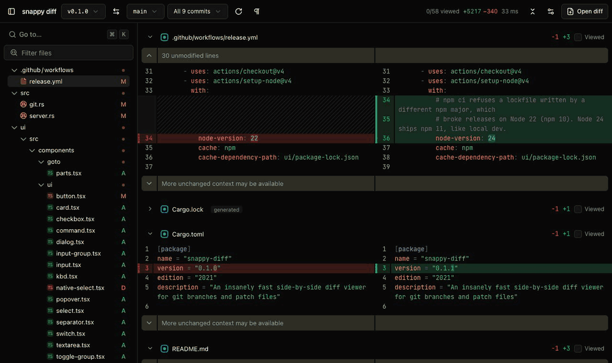

<div align="center">

# snappy diff

**An insanely fast diff viewer for git branches and patch files.**

Review a branch like a pull request, leave comments, and hand them to your AI agent.

[](https://github.com/duartecaldascardoso/snappy-diff/releases/latest)




</div>

## Install

```bash
# macOS and Linux
curl -fsSL https://raw.githubusercontent.com/duartecaldascardoso/snappy-diff/main/install.sh | sh
```

```powershell
# Windows (PowerShell)
irm https://raw.githubusercontent.com/duartecaldascardoso/snappy-diff/main/install.ps1 | iex
```

One ~4 MB download. No Node, no Rust, nothing else to install.

## Use

```bash
snappy-diff                 # default branch vs. current branch
snappy-diff main feature    # main...feature, like a pull request
snappy-diff -w              # uncommitted changes, refreshed live
snappy-diff change.diff     # a .diff or .patch file
git diff | snappy-diff -    # from stdin
```

Or drop, paste or open a diff exported from GitHub or GitLab right in the page.

## Review

- **Mark files viewed** with `v`; viewed, generated and huge files stay out of the way
- **Comment** on a line or a range from the gutter
- **Copy for AI** turns your comments into a prompt with files, lines and code
- **Go anywhere** with `⌘K`: files, commits, comments and actions
- **Pick a commit** to review one change at a time

## Keys

| | |
| --- | --- |
| `⌘K` | Go to a file, commit, comment or action |
| `j` `k` | Next / previous file |
| `v` | Mark file as viewed |
| `/` | Filter the file tree |
| `⌘B` | Toggle the sidebar |
| `?` | Settings: layout, themes, fonts, icons |

## Build from source

```bash
npm --prefix ui ci && npm --prefix ui run build
cargo install --path .
```
